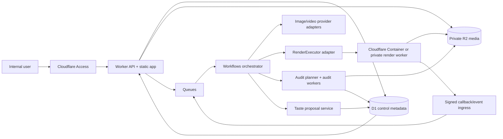

# Creative Hook Lab — Technical delta v3: Video Assembly & Taste Runtime

> **Ngày đối chiếu:** 2026-10-20 (Asia/Bangkok)  
> **Quan hệ:** bổ sung cho `PRD.md`, `TECHNICAL-SPEC.md`, `DESIGN-v2-SPATIAL-STUDIO.md` và `MOTION-CONTRACT-v2.md`; không thay thế các tài liệu đó  
> **Trạng thái:** target architecture, chưa có renderer/backend/provider runtime, chưa chạy model, chưa tiêu credit và chưa deploy

## 1. Mục tiêu và quyết định chính

Delta này thêm bốn năng lực:

1. quản lý nhiều project trong workspace với ranh giới auth, storage, cache và memory rõ ràng;
2. tạo video 45 hoặc 60 giây bằng cách lập kế hoạch, sinh/chọn và ráp các shot ngắn, gồm nguồn 15/30 giây khi phù hợp;
3. chạy AI audit cho cut/edit/motion, sửa có giới hạn rồi xuất bản render có lineage;
4. tích lũy taste sau mỗi run hoàn tất dưới dạng preference/rule có version và evidence, không gọi đó là huấn luyện trọng số model.

Quyết định kiến trúc:

- **Cloudflare là control plane:** Access, Worker API/static app, D1, R2, Queues và Workflows điều phối công việc.
- **Render là compute plane riêng:** FFmpeg, browser renderer hoặc renderer khác chạy trong container/VM riêng có CPU, RAM, disk và binary được pin. Không chạy FFmpeg nặng trực tiếp trong Worker isolate.
- **EDL là nguồn chân lý timeline:** mọi agent, node editor, HyperFrames adapter và FFmpeg adapter đều đọc hoặc biên dịch từ một Edit Decision List bất biến.
- **Skill không phải executable:** runtime không đọc `SKILL.md` rồi “tự biết” cắt dựng. Chỉ package/recipe đã đăng ký, allowlist và qua validation mới được chạy.
- **Taste học bằng evidence:** một run chỉ có thể đề xuất rule mới sau khi render và audit hoàn tất. Self-score của agent là diagnostic, không phải ground truth về chất lượng hay hiệu quả quảng cáo.

## 2. Ranh giới hạ tầng

### 2.1 Vì sao không render video trong Worker

Theo tài liệu chính thức hiện tại, Workers có 128 MB memory; Workers Paid có CPU mặc định 30 giây và có thể cấu hình tối đa 5 phút cho một HTTP invocation. Queue consumer có wall time 15 phút; `waitUntil()` chỉ kéo dài tối đa 30 giây sau response/disconnect. Workflows có thể chờ I/O lâu và resume, nhưng mỗi step vẫn chịu CPU limit. Đây là hạ tầng phù hợp để xác thực, điều phối, theo dõi và retry; không phải bằng chứng rằng một encode 45/60 giây với FFmpeg sẽ chạy an toàn trong isolate.

Nguồn: [Workers limits](https://developers.cloudflare.com/workers/platform/limits/), [Workflows limits](https://developers.cloudflare.com/workflows/reference/limits/), [Queues delivery guarantees](https://developers.cloudflare.com/queues/reference/delivery-guarantees/).

### 2.2 Hai lựa chọn render plane

| Lựa chọn | Khi dùng | Gate trước production |
|---|---|---|
| Cloudflare Containers | muốn cùng control plane, Docker image pin theo digest, tải binary/codec riêng | benchmark cold start, codec availability/license, scratch disk, network egress, concurrency, cancellation và cost trên workload thật |
| Private container worker/cloud compute | cần kiểm soát VM/GPU, region, autoscaling hoặc codec/driver ngoài giới hạn Containers | mTLS/service token, private egress policy, queue leasing, image digest, autoscaling/cost guard, patching và isolation |

Cloudflare Containers hiện hỗ trợ container image và các instance tới 4 vCPU, 12 GiB memory, 20 GB disk theo default/current limits; đây là capability platform, không phải kết quả benchmark của app. Chọn provider qua `RenderExecutor` interface sau pilot. Nguồn: [Containers limits](https://developers.cloudflare.com/containers/platform/limits/), [Containers/Sandboxes GA](https://developers.cloudflare.com/changelog/post/2026-04-13-containers-sandbox-ga/).

### 2.3 Kiến trúc mục tiêu



Control plane never proxies full video bytes through D1. Browser and render worker use short-lived, object-scoped signed R2 URLs or scoped temporary credentials. Presigned URLs are bearer tokens; log only object IDs/key hashes and expiry, never the full URL. Source: [R2 presigned URLs](https://developers.cloudflare.com/r2/api/s3/presigned-urls/).

## 3. Runtime package registry

### 3.1 Package is executable code, not prose instruction

An installed authoring skill may teach an agent how to plan a composition. It does not make its examples, CLI or dependencies available to the web app. Production runtime accepts only an immutable `MotionPackageManifest`:

```ts
type MotionPackageManifest = {
  packageId: string;
  version: string;                  // semver or immutable vendor version
  artifactDigest: string;           // sha256/image digest
  sourceCommit?: string;
  license: { spdx?: string; noticeAssetId?: string; commercialUse: "allowed"|"review_required"|"blocked" };
  executor: "ffmpeg"|"hyperframes"|"custom_container";
  entrypoint: string;
  runtimeImageDigest: string;
  supportedOperations: string[];    // exact allowlist
  unsupportedOperations: string[];
  inputContractVersion: string;
  outputContractVersion: string;
  requiredCapabilities: string[];   // binary/filter/font/codec/browser
  resourceProfile: { cpu: number; memoryMiB: number; scratchMiB: number; timeoutSec: number };
  networkPolicy: "none"|"signed_r2_only"|"allowlisted_hosts";
  validationReceiptId: string;
  status: "candidate"|"validated"|"disabled"|"revoked";
};
```

Activation requires:

1. source/license review and immutable digest;
2. isolated build without secrets baked into image;
3. capability probe (`ffmpeg -filters`, encoders, fonts, headless browser where applicable);
4. known-input golden render and `ffprobe` output checks;
5. resource measurement on the intended executor;
6. security scan and egress policy;
7. version-bound validation receipt.

Any operation absent from `supportedOperations` fails closed with `RECIPE_UNSUPPORTED`; an agent cannot invent a shell command or import a helper from a skill directory at runtime.

### 3.2 Initial adapters

| Adapter | Intended subset | Boundary |
|---|---|---|
| FFmpeg assembly | probe, trim, normalize, scale/pad/crop, concat, crossfade, audio mix/duck, overlay, subtitle burn, encode, thumbnails/contact sheets | available only after the chosen image proves binaries/filters/codecs; concat-copy only when stream parameters are compatible |
| HyperFrames | validated HTML composition → deterministic timeline/render/export | optional; do not claim it is installed, licensed for the deployment, render-compatible or production-ready until a pinned package passes the manifest gates |
| Custom motion recipe | one named operation with typed input/output | no arbitrary user JS/shell; sandbox, allowlisted assets and resource bounds required |

FFmpeg's concat demuxer requires compatible streams and adjusts timestamps from file durations; inaccurate duration can create artifacts. Therefore raw generated clips are probed and normalized before fast concat, otherwise the render plan uses a filter graph/re-encode. Source: [FFmpeg concat demuxer](https://ffmpeg.org/ffmpeg-formats.html#concat), [FFmpeg filters](https://ffmpeg.org/ffmpeg-filters.html).

“Nodebase” is treated as an optional node-editor/presentation adapter until the exact product/package, version, license and runtime contract are identified. The node graph may edit/visualize the plan, but the canonical EDL remains authoritative. Removing the editor must not make projects or renders unreadable.

## 4. Long-form assembly model

### 4.1 Asset hierarchy

```text
Workspace
  └─ Project
      └─ Product
          └─ Campaign
              └─ Run
                  └─ FilmVersion (target 45s or 60s)
                      ├─ StoryRevision
                      ├─ ShotPlan[]
                      │    └─ ShotCandidate[] -> chosen AssetRevision
                      ├─ EDLRevision
                      ├─ RenderRun[]
                      ├─ AuditRun[]
                      └─ TasteEvaluation / PreferenceProposal[]
```

This hierarchy is canonical across PRD and runtime. `Run` freezes inputs, capability/model/provider snapshots, budget and idempotency context. It may create several immutable `FilmVersion` children for duration, aspect, language or repair branches. UI labels such as “video program” or “film plan” are views over these entities, not another aggregate or authorization boundary.

A FilmVersion is built from shot slots. A 45-second version may use sources planned around `15+15+15`, `30+15`, or another reviewed segmentation. A 60-second version may use `30+30`, `15×4`, or a mixed plan. Those are source/generation preferences, not timeline truth: actual clip durations come from provider capability plus `ffprobe`/metadata and are reconciled by the EDL compiler. The capability snapshot must confirm native durations; the planner may trim a source into a shorter segment but cannot silently request an unsupported 15/30-second generation.

### 4.2 Canonical EDL

```json
{
  "schemaVersion": "creative-hook-lab.edl/1.0.0",
  "edlId": "edl_...",
  "revision": 3,
  "projectId": "prj_...",
  "runId": "run_...",
  "filmVersionId": "filmv_...",
  "target": {
    "durationMs": 60000,
    "timebase": {"numerator": 1, "denominator": 30000},
    "width": 1080,
    "height": 1920,
    "fps": {"numerator": 30000, "denominator": 1001},
    "audioSampleRate": 48000,
    "loudnessTarget": {"integratedLufs": -14, "truePeakDbtp": -1}
  },
  "tracks": [
    {
      "id": "v1",
      "kind": "video",
      "clips": [
        {
          "clipId": "clip_01",
          "assetRevisionId": "assetrev_...",
          "sourceInMs": 0,
          "sourceOutMs": 15100,
          "timelineInMs": 0,
          "playbackRate": 1,
          "transitionOut": {"type": "crossfade", "durationMs": 300},
          "transformRecipeId": "recipe_reframe_9x16@1.2.0"
        }
      ]
    }
  ],
  "markers": [],
  "captionAssetRevisionId": null,
  "musicAssetRevisionId": null,
  "productRevisionId": "prodrev_...",
  "tasteProfileRevisionId": "taste_...",
  "recipeLock": [],
  "createdBy": {"type": "user|agent", "id": "..."}
}
```

Production schema must use integers/rational timebases rather than accumulated floating-point seconds. A node editor, when enabled, is a typed acyclic view of the same frozen run/EDL: it cannot add an execution cycle, connect incompatible ports, or create an alternative timeline state.

### 4.3 Timeline math

For clip `i`:

```text
source_i = sourceOut_i - sourceIn_i
played_i = source_i / playbackRate_i
```

For a single sequential primary video track:

```text
program_duration = Σ played_i - Σ overlap_i + Σ explicit_gap_i
```

where `overlap_i` is a validated transition overlap between adjacent clips. The compiler requires:

- `sourceOut > sourceIn >= 0` and range within probed duration;
- transition overlap no greater than either adjacent played duration;
- `timelineIn` equals previous visible end minus overlap unless an explicit gap/overlay is declared;
- video/audio/caption events end at or before target plus configured tolerance;
- exact output target `45000` or `60000` ms within one output frame, or an explicit owner-approved alternate duration;
- timestamps normalized to the output timebase; no hidden negative or non-monotonic PTS;
- captions calculate against output timeline after trim, speed and overlap.

The compiler emits both `renderPlan.json` and a human-readable duration ledger. A final `ffprobe` check compares encoded duration, streams, dimensions, frame rate, sample rate and codec against the frozen plan.

## 5. End-to-end video workflow

```text
BRIEF_FROZEN
 -> SHOT_PLAN_READY
 -> SHOTS_GENERATING_OR_SELECTING
 -> SHOTS_REVIEW
 -> EDL_READY
 -> PREVIEW_RENDERING
 -> PREVIEW_AUDIT
 -> REPAIR_PLANNED (0..2 rounds)
 -> FINAL_RENDERING
 -> FINAL_AUDIT
 -> READY_FOR_REVIEW | NEEDS_HUMAN | FAILED | NEEDS_RECONCILIATION
```

These are orchestration checkpoints, not a second public state machine. They map to PRD states as follows: `draft` covers brief/plan/EDL work; `validated` follows contract and capability checks; `quoted` and `confirmed` precede spend; `running` covers generation/render/audit/repair jobs; `assembled` means a render exists; `audited` means the declared audit scope completed; terminal business state is `completed | escalated | failed | cancelled`. A FilmVersion separately moves through `draft → rendered → audit_failed|needs_review → approved|rejected|superseded`. `NEEDS_RECONCILIATION` is an operational hold inside the relevant run/job, never a fabricated success or refund state.

### 5.1 Steps

1. Freeze product, claims, target duration, placement, taste revision and budget envelope.
2. Story/shot agent creates slots with purpose, duration budget, continuity locks, first/end frame, source requirement and allowed mutation.
3. Each slot either selects an approved source clip or submits a provider generation job. Provider jobs inherit existing idempotency/budget rules.
4. Normalize chosen clips to a mezzanine contract or record why passthrough is safe.
5. Edit agent produces EDL revision; compiler validates timeline math and recipe support.
6. Render preview with a reserved render budget and immutable executor/package snapshot.
7. Audit agent creates structural, sampled visual and optional full-playback findings. Coverage type is explicit.
8. Repair planner may create at most two bounded repair rounds under the same run budget. It changes only cited intervals/fields and creates a new EDL revision.
9. Final render uses frozen EDL, asset revisions, recipe locks and executor image digest.
10. Final audit produces a release candidate for a human reviewer. Only a completed audited run may propose taste updates.

Browser preview is explicitly approximate. It may show proxy media and approximate transitions, but only a render executor receipt bound to EDL/input/package hashes plus output probe/checksum can establish a master render. Closing the browser must not terminate or erase an asynchronous run.

### 5.2 Provider retries with uncertain state

For generation calls:

- persist an intent record and reservation before submit;
- use provider idempotency key when documented;
- persist provider request ID immediately when returned;
- on timeout, query provider by request ID/idempotency key before resubmit;
- if acceptance or charge cannot be proven, set `NEEDS_RECONCILIATION`; do not create a duplicate generation automatically;
- late/out-of-order callbacks are deduped and cannot overwrite a terminal state.

Render executor commands use `render_run_id + edl_hash + executor_digest` as business key. Queue delivery is at-least-once, so duplicate messages must attach to the same run or become a no-op; never promise exactly-once.

## 6. AI audit and bounded repair

### 6.1 Audit types and truth labels

| Audit | Coverage label | What it may establish |
|---|---|---|
| Structural | `full_structural` | EDL validity, duration ledger, missing asset, recipe support, output metadata, silent/black interval heuristics |
| Frame sample | `sampled_frames` | observed defects only at named timestamps/regions; cannot prove every frame |
| Cut windows | `all_cut_windows` | contact sheets/waveform around every edit boundary; does not prove the body of each clip |
| Playback | `full_playback_human` or `full_playback_instrumented` | reviewer/tool actually traversed the full duration; still scoped to checks recorded |
| Product/claim | `sampled_product` or `full_product_check` | product/packaging/claim comparison with named source revision and coverage |
| Performance result | external experiment evidence | never inferred from a beautiful render or self-score |

Each finding contains `findingId`, severity, taxonomy, time range/frame, track/clip IDs, observed evidence asset, expected rule/source, confidence, proposed mutation and review state. “Full audit” is forbidden unless coverage truly spans the full declared target for the named checks.

### 6.2 Repair policy

- Maximum `2` automatic repair rounds per render run.
- Every round has an incremental budget cap, allowed operations and deadline.
- Before spend, show the patch plan, affected segments, capability snapshot and quote; execute only under the configured user/authority confirmation policy.
- Repair creates new EDL/package/input revision; it never mutates the previous render evidence.
- Same finding recurring after round 2 becomes `NEEDS_HUMAN` with exact interval and attempted changes.
- A repair cannot unlock product/claim/correct-use invariants or substitute an unapproved asset.
- A self-score may prioritize inspection but cannot close its own finding without an independent check defined by policy.

## 7. Taste memory and learning

### 7.1 What is learned

Taste is a versioned decision layer, not hidden model training:

```ts
type TasteRule = {
  id: string;
  scope: { workspaceId: string; projectId?: string; brandId?: string; market?: string; channel?: string };
  statement: string;
  kind: "preference"|"avoid"|"conditional"|"invariant";
  condition?: string;
  evidenceRefs: string[];
  sourceRunIds: string[];
  confidence: "candidate"|"supported"|"contested";
  authority: "agent_proposed"|"reviewer_approved"|"owner_locked";
  supersedes?: string;
  validFrom: string;
  validUntil?: string;
  status: "proposed"|"active"|"rolled_back"|"stale"|"conflicted";
};
```

After each `FINAL_AUDIT` run, a learner may propose:

- which creative/motion decisions were retained or repeatedly rejected;
- which failure patterns were verified and how they were fixed;
- context where a rule applies and counterexamples;
- links to exact EDL/render/audit/reviewer/performance evidence.

It may not conclude “this style converts” from an agent score, one attractive render or missing experiment data.

Every run stores a terminal episode record. Completed audited runs may propose candidate taste rules; failed, canceled or aborted runs record failure evidence and status but cannot activate a positive rule. Callback retry is deduped so one run creates one logical episode.

### 7.2 Promotion, conflict and rollback

1. Store candidate proposal separately from active taste profile.
2. Auto-activation is allowed only for low-risk preferences under an explicit workspace policy; owner locks and claim/product rules always require configured authority.
3. Retrieval ranks by scope specificity, status, recency and evidence quality. Project-specific rule does not silently become workspace-global.
4. Contradictory active rules create `taste_conflict`; generation pauses only when the conflict affects a required decision, otherwise it surfaces a warning.
5. Reviewer can rollback to a previous profile revision; derived future runs retain the revision they used.
6. Stale rule expires or becomes `stale`; it is not deleted from audit history.
7. Performance-linked rules require experiment context consistent with PRD winner discipline.

Vector retrieval is optional. Embeddings/indexes hold retrieval aids and references, not authorization or canonical rule text. D1/versioned artifacts remain authoritative. Cache keys include workspace, project/brand scope, taste profile revision, source revision and model/embedding snapshot; no cross-project cache hit without an explicit workspace policy.

## 8. Project isolation and data model delta

Add logical entities:

| Entity | Core fields |
|---|---|
| `products` | workspace/project, active Product Lock revision, source library, variant/status |
| `campaigns` | workspace/project/product, objective, audience, placement, taste brief |
| `runs` | full ancestor IDs, frozen inputs/capability snapshots, state, budget, idempotency context |
| `film_versions` | run, parent version, target duration/spec, active story/EDL/taste revisions, state |
| `shot_plans` / `shot_slots` | run/film version, purpose, duration budget, continuity locks, source policy, order |
| `shot_candidates` | slot, asset revision, provider job, review status, score provenance |
| `edl_revisions` | immutable canonical JSON, hash, parent revision, compiler version |
| `motion_packages` / `package_versions` | manifest, digest, license, executor, validation receipt, status |
| `recipe_locks` | EDL revision, package/version, operation, config hash |
| `render_runs` | EDL hash, executor/image digest, state, budget, output asset, attempts |
| `render_events` | event ID, state, payload hash, timestamps; dedupe |
| `audit_runs` / `audit_findings` | coverage, tool/model snapshot, evidence, disposition |
| `repair_rounds` | source finding set, allowed mutation, budget, EDL before/after |
| `taste_profiles` / `taste_rules` | scope, revision, authority, evidence, status |
| `taste_conflicts` | rule pair/set, affected scope, resolution/rollback |
| `retrieval_snapshots` | query, scope/filter, index/model snapshot, returned evidence IDs |

Every row and object is scoped to `workspace_id`; descendants carry `project_id` and the ancestor IDs required to prove `Product → Campaign → Run → FilmVersion`. Authorization checks the full relationship, never trusts an object key supplied by the client. R2 prefix is opaque and workspace/project scoped. Copying to another project creates a new scoped object with provenance and an explicit Product/source remap; it never shares a mutable child. Delete/export workflows enumerate render derivatives, audit media, package locks and taste evidence impact before tombstoning.

## 9. API delta

| Method | Path | Result |
|---|---|---|
| POST | `/api/v1/products/:id/campaigns` | create scoped campaign, no generation |
| POST | `/api/v1/campaigns/:id/runs` | freeze inputs/capability/taste/budget context |
| POST | `/api/v1/runs/:id/film-versions` | create 45/60 target version or repair/aspect branch |
| POST | `/api/v1/film-versions/:id/shot-plans:generate` | versioned plan job |
| POST | `/api/v1/shot-slots/:id/candidates:generate` | reserve + async provider jobs |
| POST | `/api/v1/film-versions/:id/edl-revisions` | validate and freeze EDL |
| POST | `/api/v1/edl-revisions/:id/compile` | recipe support + duration ledger + render quote |
| POST | `/api/v1/render-runs` | reserve render budget and enqueue |
| GET | `/api/v1/render-runs/:id` | normalized progress, executor/package snapshot |
| POST | `/api/v1/render-runs/:id:cancel` | best-effort cancel; reconciliation if uncertain |
| POST | `/api/v1/render-events/:binding` | signed/deduped worker callback |
| POST | `/api/v1/render-runs/:id/audits` | explicit coverage request |
| POST | `/api/v1/audit-runs/:id/repairs` | create bounded repair round |
| POST | `/api/v1/audit-runs/:id/taste-proposals` | propose rules after eligible completion |
| POST | `/api/v1/taste-proposals/:id:review` | approve/reject with scope and authority |
| POST | `/api/v1/taste-profiles/:id:rollback` | new revision pointing to selected prior state |

Permission additions: `video.plan`, `shot.generate`, `edl.write`, `render.run`, `audit.run`, `repair.run`, `taste.propose`, `taste.review`, `taste.lock`, `package.admin`. Spend and approval thresholds remain workspace policy; this document does not add a mandatory pause to every operation.

## 10. Budget and concurrency

One video program has separate reservations for:

- shot/provider generation;
- preview render;
- audit compute/model calls;
- each repair round;
- final render and delivery derivatives.

Quote records assumptions: candidate count, duration, resolution, provider/model snapshot, render executor/profile, codec, audit coverage and repair allowance. The system rejects a plan whose worst-case reservation exceeds project/run caps. Unused repair allowance is released. Uncertain provider or executor charges remain reserved and `NEEDS_RECONCILIATION` until confirmed.

Concurrency limits apply at workspace, project, provider and executor levels. Render jobs use leases with heartbeat and expiry, but expiry alone does not authorize a duplicate render: check output marker/event/object hash first.

## 11. Security and supply chain

- Render workers receive only short-lived job credentials and object-scoped URLs; no workspace-wide R2 secret.
- Callback uses mTLS, Cloudflare service token or request signing plus unguessable binding; handler then verifies job/executor state before mutation.
- Media is probed in an isolated process with size/duration/stream/decode limits. Reject unexpected archive, executable or excessive stream counts.
- Package image runs non-root, read-only base filesystem where possible, bounded scratch, no Docker socket and deny-by-default network.
- Pin image/package/font/recipe/model/compiler digests; generate SBOM/license notices for distributable output dependencies.
- User-supplied node graphs or HTML cannot execute arbitrary code. Compile a typed allowlisted graph into EDL/recipe operations.
- Redact signed URLs, prompts with sensitive data, local file paths and provider secrets from logs/audit screenshots.

## 12. Observability and evidence

Propagate `trace_id`, `workspace_id`, `project_id`, `product_id`, `campaign_id`, `run_id`, `film_version_id`, `shot_slot_id`, `provider_job_id`, `edl_hash`, `render_run_id`, `executor_digest`, `audit_run_id` and `taste_profile_revision`.

Record:

- queue delivery, workflow step/attempt and idempotency decision;
- provider submit/lookup/callback with redacted IDs;
- render command template ID and normalized args hash, never arbitrary shell text;
- resource duration/CPU/memory/scratch/bytes when the executor supplies them;
- output object checksum and `ffprobe` receipt;
- audit coverage and exact evidence intervals;
- repair diff and budget used;
- taste proposal, authority decision, conflict, activation and rollback.

Dashboard states must distinguish `waiting for provider`, `rendering`, `auditing`, `needs human`, `reconciling charge`, `failed`, and `canceled`. A generic 95% progress must not be fabricated when the executor has no reliable progress signal.

## 13. Build phases and acceptance

### Phase A — contract-only

- Define JSON Schema for EDL, package manifest, duration ledger, audit report and taste rule/proposal.
- Unit/property tests cover trim/rate/overlap math, invalid transitions, 45/60 targets, revision/hash linkage and cross-project authorization.
- Validate package manifest/license/unsupported-operation rejection.

### Phase B — mock executor vertical slice

- One 45-second demo from three local 15-second synthetic clips.
- D1/R2/Queue/Workflow may be mocked locally; no paid provider.
- Duplicate queue message produces one logical render run.
- Simulated timeout after submit enters lookup/reconciliation path.

### Phase C — isolated FFmpeg executor

- Pin a container image and capability receipt.
- Render both 45 and 60-second fixtures; `ffprobe` agrees with EDL within one frame.
- Verify all cut windows, audio continuity, caption timing and object checksum.
- Cancel, worker crash, callback replay and insufficient scratch produce explicit recoverable states.

### Phase D — optional motion adapter

- Validate one HyperFrames or custom recipe end-to-end against the same EDL subset.
- Unsupported features fail before spend; adapter diff identifies every transformed/omitted field.
- Do not enter this phase merely because a related skill exists locally.

### Phase E — audit, repair and taste pilot

- Audit receipt clearly distinguishes full structural, sampled frames, cut windows and playback coverage.
- Inject known defects; findings point to exact intervals and two-round cap stops recurring failure.
- Completed audited run creates a `proposed` scoped rule; no auto-globalization.
- Approve, conflict, stale and rollback tests retain exact historical profile revision.
- Agent self-score never upgrades a rule or declares winner without configured external/reviewer evidence.

### Release gates

1. Real project auth isolation and signed-object access tests pass.
2. Exact executor/provider/package capability snapshots exist.
3. Budget and idempotency/reconciliation failure tests pass.
4. Pixel/playback review covers output, not only source or contact sheets.
5. Vietnamese captions/fonts are inspected full resolution when used.
6. Owner reviews the UX and taste policy; no design artifact substitutes for that approval.

## 14. Explicit non-claims

This document does not establish that Cloudflare Containers is the chosen renderer, FFmpeg/HyperFrames exists in the deployed environment, Nodebase has been selected, any skill is callable by the app, any model can audit a full video, taste improves conversion, a 45/60-second render has passed, or the application has been implemented. Those claims require the phase-specific evidence above.
