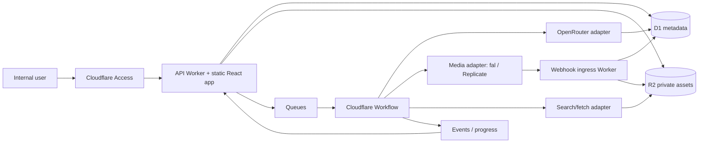

# Creative Hook Lab — Đặc tả kỹ thuật

> Trạng thái: `DRAFT / PRD-first visual concept stage`  
> Ngày đối chiếu nhà cung cấp: 2026-10-20 (Asia/Bangkok)  
> Phạm vi bản này: kiến trúc và hợp đồng kỹ thuật để đội triển khai tiếp; chưa có ứng dụng chạy, chưa gọi API trả phí, chưa deploy.

## 1. Mục tiêu và ranh giới

Creative Hook Lab là web app nội bộ biến ảnh sản phẩm/bao bì và thông tin người dùng thành một hệ thống giả thuyết creative có thể kiểm chứng:

1. nhận diện sản phẩm nhưng không biến suy đoán từ ảnh thành “sự thật”;
2. tách claim nhìn thấy được, claim do người dùng xác nhận và claim cần nghiên cứu;
3. nghiên cứu target, pain point, use case, motivator và tín hiệu trend bằng nguồn có URL/thời điểm;
4. tạo creative territories, hooks và ma trận white-space;
5. xuất `mega prompt JSON` và `negative constraints JSON` có version;
6. sau khi tích hợp provider, tạo ảnh/video bất đồng bộ, giữ lineage để nhân bản concept thắng;
7. quản lý chi phí, provenance, phê duyệt nội bộ và lịch sử phiên bản.

### Không thuộc phạm vi hiện tại

- Không tự động chạy quảng cáo, đăng social hoặc tuyên bố “viral/winner”.
- Không coi output LLM là nghiên cứu nếu không có công cụ web và source record.
- Không tự gọi provider khi chưa có khóa, budget và thao tác Generate rõ ràng.
- Không dùng ảnh AI để ghi đè product truth lấy từ ảnh thật/bao bì.
- Không đưa API key xuống browser.
- Không cam kết exactly-once cho queue, workflow hoặc webhook.

## 2. Nguyên tắc kiến trúc

- **Evidence before synthesis:** mỗi claim có `source_type`, `source_id`, trích đoạn, thời điểm và mức tin cậy.
- **Human correction wins:** chỉnh sửa/xác nhận của người dùng tạo revision mới và được ưu tiên hơn inference cũ.
- **Prompt là artifact:** prompt có schema, version, hash, author model và input lineage; không lưu như chuỗi text vô danh.
- **Provider là adapter:** domain không phụ thuộc model slug hay field riêng của fal/Replicate/OpenRouter.
- **Async by default:** image/video generation và deep research là job dài; API trả `202` + job ID.
- **At-least-once safe:** mọi side effect có idempotency key, dedupe và state transition đơn điệu.
- **Budget before spend:** reserve chi phí trước submit, reconcile bằng usage thực tế sau terminal event.
- **Internal by default:** Cloudflare Access bảo vệ toàn app; asset sản phẩm nằm private trong R2.

## 3. Kiến trúc mục tiêu



### Thành phần

| Thành phần | Trách nhiệm | Không được làm |
|---|---|---|
| React + TypeScript + Vite | UI upload, review evidence, motivator map, hook lab, prompt inspector, job progress | giữ secret hoặc gọi provider có API key trực tiếp |
| Worker API | auth context, validation, API domain, signed upload/download, idempotency | chờ đồng bộ hàng phút cho generation |
| D1 | metadata, revisions, lineage, job state, budgets, audit | chứa binary ảnh/video lớn |
| R2 private | source asset, snapshot nghiên cứu, generated asset | public bucket cho tài liệu nội bộ |
| Queues | hấp thụ burst, tách request khỏi orchestration | được coi là exactly-once |
| Workflows | các bước dài, retry, wait webhook/poll, resume | gói toàn pipeline vào một step duy nhất |
| OpenRouter adapter | text/vision planning, research synthesis, taste, JSON output | tự được coi là có web access |
| Research adapter | search/fetch, snapshot, normalize, citation | đưa snippet không truy xuất được thành nguồn xác minh |
| Media adapters | compile canonical prompt, submit/poll/cancel/normalize output | làm rò secret hoặc giả lập field provider không hỗ trợ |
| Webhook ingress | verify, dedupe, transition state, enqueue persistence | tin payload chỉ vì có `request_id` |

### Cloudflare hosting

- Dùng Workers Static Assets cho SPA và Worker cho `/api/*`, không dùng Workers Sites cũ.
- `assets.not_found_handling = "single-page-application"`; cấu hình `run_worker_first` cho `/api/*` và webhook routes.
- Cloudflare Access self-hosted application bảo vệ hostname nội bộ. API vẫn kiểm tra identity/role ở application layer; không dựa duy nhất vào việc UI đã qua Access.
- Chú ý: Workers Static Assets có giới hạn Access context trong user Worker; thiết kế auth phải được test bằng request thực tế và xác minh JWT/header theo cơ chế Access áp dụng cho route.

## 4. Domain model và lineage

### Aggregate chính

- `Workspace`: tenant nội bộ, policy và budget.
- `Project`: một sản phẩm/campaign đang nghiên cứu.
- `ProductRevision`: snapshot bất biến của identity/features/claims sau mỗi lần xác nhận.
- `Asset`: source image, packaging, research snapshot, creative output hoặc derivative.
- `EvidenceItem`: quan sát, OCR, user statement, URL source hoặc inference.
- `Claim`: phát biểu chuẩn hóa kèm trạng thái `observed | user_confirmed | sourced | inferred | disputed`.
- `ResearchRun`: tập truy vấn, nguồn, thời điểm, coverage và synthesis.
- `Insight`: target/pain/use case/motivator/barrier/benefit/trend signal có citation.
- `CreativeTerritory`: motivator + audience + use case + tension + payoff + taste direction.
- `Hook`: một mở đầu creative có format, angle, hypothesis và scoring rubric.
- `PromptArtifact`: canonical JSON + compiled provider request + schema version.
- `GenerationJob`: provider request lifecycle, reservation và terminal result.
- `ConceptLineage`: parent-child cho remix/duplicate/winner clone.

### Quy tắc truth

Ưu tiên khi xung đột: `user_confirmed > sourced authoritative > directly observed > inferred`. “Được model nói” không tạo ra authoritative claim. Mọi thay đổi tạo revision; output cũ vẫn trỏ đúng revision đã dùng.

## 5. State machine

### Project pipeline

```text
DRAFT
  -> INGESTING
  -> NEEDS_CONFIRMATION | READY_FOR_RESEARCH
  -> RESEARCHING
  -> RESEARCH_REVIEW
  -> TERRITORIES_READY
  -> HOOKS_READY
  -> PROMPTS_READY
  -> GENERATING
  -> ASSETS_READY
  -> ARCHIVED
```

`FAILED` không thay thế state nghiệp vụ; lỗi nằm ở run/job cụ thể để project có thể tiếp tục từ checkpoint hợp lệ.

### Job lifecycle

```text
CREATED -> BUDGET_RESERVED -> QUEUED -> SUBMITTED -> RUNNING
        -> SUCCEEDED | FAILED | CANCELED | EXPIRED | NEEDS_RECONCILIATION
```

Chỉ cho phép transition tiến tới terminal. Webhook đến trễ hoặc lùi state bị ghi audit và bỏ qua.

## 6. Pipeline nghiệp vụ

### 6.1 Ingest và product truth

1. `POST /uploads` tạo asset shell và presigned R2 PUT URL thời hạn ngắn.
2. Browser upload trực tiếp R2; `POST /uploads/{id}/complete` gửi checksum, MIME, size.
3. Backend kiểm tra magic bytes, size/dimension, checksum, ownership; file không hợp lệ vào quarantine.
4. Vision/OCR tạo `EvidenceItem` dạng `observed` và `inferred`, luôn có vùng/bounding box nếu có.
5. UI hiển thị bảng “nhìn thấy / suy luận / cần xác nhận”; user sửa và xác nhận thành `ProductRevision`.

Không tự suy ra thành phần, chứng nhận, công dụng sức khỏe, vật liệu hoặc dung tích nếu bao bì/nguồn không đủ rõ.

### 6.2 Research có nguồn

Research run bắt buộc khai báo:

- market, language, platforms, lookback window, audience hypothesis;
- queries và tool đã dùng;
- URL canonical, title, publisher/creator, published/fetched timestamp;
- raw snapshot hoặc content hash trong R2 nếu điều khoản nguồn cho phép;
- excerpt ngắn, claim mapping, source quality và recency;
- dấu hiệu trend (velocity, repetition, cross-source spread) tách khỏi kết luận.

Model Gemini 3.8 Flash chỉ làm researcher khi request được cấp `openrouter:web_search`/`web_fetch` hoặc research adapter tương đương. Không có tool result thì output chỉ là hypothesis và không được gắn `sourced`.

### 6.3 Motivator strength

Mỗi motivator được chấm trên rubric 0–4, lưu cả evidence lẫn phản chứng:

| Trục | Câu hỏi kiểm chứng |
|---|---|
| Pain salience | vấn đề có xảy ra thường xuyên và được target nhận biết không? |
| Consequence | không giải quyết gây mất thời gian, tiền, sự tự tin hay cơ hội gì? |
| Product fit | đặc điểm thật của sản phẩm giải quyết cơ chế nào? |
| Immediacy | hook có làm người xem nhận ra tình huống trong 1–3 giây không? |
| Believability | claim có chứng cứ/visual proof và tránh phóng đại không? |
| Creative range | motivator tạo được nhiều use case/format mà không lặp ý không? |

Không dùng tổng điểm như xác suất thắng. Nó là công cụ xếp ưu tiên hypothesis để test.

### 6.4 Trend-to-taste synthesis

Trend không được copy nguyên concept. Hệ thống ghép:

`verified product truth + motivator + real use case + audience tension + current format signal + brand constraints`.

Output gồm: format grammar, pacing, framing, creator/brand balance, lo-fi/hi-fi, emotional/functional axis, saturation risk, expiration date và nguồn. Taste agent phải chỉ ra phần nào từ evidence, phần nào là quyết định sáng tạo.

### 6.5 Hook generation và duplication

Hook schema tối thiểu:

```json
{
  "hook_id": "hk_...",
  "territory_id": "ct_...",
  "format": "image|video",
  "opening_beat": "...",
  "audience_tension": "...",
  "motivator": "...",
  "use_case": "...",
  "proof_mechanism": "...",
  "payoff": "...",
  "variants": ["..."],
  "claim_ids": ["clm_..."],
  "source_ids": ["src_..."],
  "hypothesis": "Nếu ... thì ... vì ...",
  "risk_flags": []
}
```

Clone concept thắng phải giữ `parent_concept_id`, locked elements, changed variables và lý do. Không gắn `winner` nếu chưa nhập metric ngoài hệ thống (CTR, thumb-stop, CVR...) với attribution rõ ràng.

## 7. Model và capability registry

Không lưu model bằng label UI. Registry lưu:

```ts
type ModelCapability = {
  provider: "openrouter" | "fal" | "replicate";
  endpointId: string;
  task: "plan" | "research" | "taste" | "prompt" | "image" | "video";
  inputModalities: string[];
  outputModalities: string[];
  supportsStructuredOutput: boolean;
  supportsTools: boolean;
  supportsNegativePrompt: boolean | "unknown";
  supportsWebhook: boolean;
  maxInputs?: number;
  priceSnapshotId?: string;
  verifiedAt: string;
  enabled: boolean;
};
```

Các ID đã xác minh trên trang chính thức được ghi ở `provider-research.md`. Trước khi enable ở production, deployment phải chạy capability sync/preflight, lưu response hash và khóa registry revision dùng cho từng job.

### Vai trò mặc định

| Vai trò | Ưu tiên | Fallback | Ghi chú |
|---|---|---|---|
| Planner/taste | `anthropic/claude-opus-5.5` | admin-configured | structured output, không mặc định web |
| Deep research synthesis | `google/gemini-3.8-flash` + search/fetch tools | same capability class | nguồn do tool cung cấp |
| Mega prompt writer | `anthropic/claude-opus-5.5` hoặc `openai/gpt-6.1-sol` | registry policy | JSON Schema bắt buộc |
| Image | fal GPT Image 2.5 variant | approved Replicate endpoint | chọn `flare`/`sunburst` theo quality/cost policy |
| Video | fal Gemini Omni Flash 1.1 / Seedance 2.5 | approved Replicate endpoint | endpoint theo text/image/reference task |

## 8. Canonical mega prompt và negative constraints

### Nguồn canonical duy nhất

Technical spec không định nghĩa một payload song song. Nguồn sự thật cho cấu trúc và tên field là:

- [`contracts/mega-prompt.schema.json`](../contracts/mega-prompt.schema.json) — `creative-hook-lab.mega-prompt/1.0.0`;
- [`contracts/negative-prompt.schema.json`](../contracts/negative-prompt.schema.json) — `creative-hook-lab.negative-prompt/1.0.0`;
- [`examples/image-mega-prompt.demo.json`](../examples/image-mega-prompt.demo.json) và [`examples/image-negative-prompt.demo.json`](../examples/image-negative-prompt.demo.json);
- [`examples/video-mega-prompt.demo.json`](../examples/video-mega-prompt.demo.json) và [`examples/video-negative-prompt.demo.json`](../examples/video-negative-prompt.demo.json).

Hai JSON là artifact provider-neutral, có revision và liên kết bằng `negativePrompt.megaPromptId = megaPrompt.promptId`. Mega prompt chứa authorship, provenance, evidence, approved claims, product lock, strategy, taste, output và phần creative riêng cho image/video. Negative prompt chứa typed constraints, severity, scope và source. Contract examples là synthetic fixtures; metadata của chúng nói rõ không có model invocation hay byte hash thật.

Schema validation chưa đủ cho các quan hệ chéo. `scripts/validate-contracts.py` kiểm thêm evidence/claim/reference resolution, author fixture boundary, aspect ratio, media kind, exact overlay claim, video timeline, negative pair linkage, shot scope và nhóm constraint bắt buộc. Runtime vẫn phải ghi prompt hash, product revision ID, hook/concept lineage và model snapshot trong các bảng tương ứng; không thêm field tùy ý vào JSON canonical nếu chưa nâng schema version.

### Compile theo provider

1. Adapter đọc capability snapshot.
2. Validate cả hai contract và semantic rules trước khi compile.
3. Nếu endpoint có `negative_prompt`, map các constraint hỗ trợ sang field đó.
4. Nếu không có field negative riêng, áp `policy.unsupportedHandling`: chuyển constraint thành mệnh đề tích cực trong prompt chính, omit-and-report chỉ khi severity cho phép, hoặc fail closed. Không nhét JSON nguyên khối nếu provider chỉ nhận natural language; `must_not` không được silently drop.
5. Field không thể biểu diễn phải vào `compile_warnings`; compiler record ghi mọi field transformed/omitted.
6. Lưu `canonical_hash`, `compiled_request_redacted`, `adapter_version` và `provider_schema_hash`.
7. Secret, presigned URL và PII bị redact trước khi log.

## 9. API contract (v1)

Tất cả mutation nhận `Idempotency-Key`; response có `request_id`, `resource_version`, `trace_id`.

### Project và upload

| Method | Path | Kết quả |
|---|---|---|
| POST | `/api/v1/projects` | tạo project |
| GET | `/api/v1/projects/:id` | aggregate summary |
| POST | `/api/v1/projects/:id/uploads` | asset shell + presigned PUT |
| POST | `/api/v1/uploads/:id/complete` | verify checksum/MIME, enqueue ingest |
| GET | `/api/v1/assets/:id/url` | presigned GET theo quyền |
| POST | `/api/v1/projects/:id/product-revisions` | xác nhận/correct product truth |

### Research và creative

| Method | Path | Kết quả |
|---|---|---|
| POST | `/api/v1/projects/:id/research-runs` | `202`, research job |
| GET | `/api/v1/research-runs/:id` | sources, coverage, status |
| POST | `/api/v1/projects/:id/territories:generate` | versioned territories |
| POST | `/api/v1/territories/:id/hooks:generate` | hook set |
| POST | `/api/v1/hooks/:id/prompts:compile` | canonical + provider preview |
| POST | `/api/v1/concepts/:id/clone` | derivative với locked/changed fields |

### Generation và jobs

| Method | Path | Kết quả |
|---|---|---|
| POST | `/api/v1/generations:estimate` | estimate + expiry, không reserve |
| POST | `/api/v1/generations` | reserve budget, enqueue, `202` |
| GET | `/api/v1/jobs/:id` | normalized progress/status |
| POST | `/api/v1/jobs/:id:cancel` | best-effort cancel |
| POST | `/api/v1/webhooks/fal/:binding` | verified callback |
| POST | `/api/v1/webhooks/replicate/:binding` | verified/deduped callback |

Error body dùng `application/problem+json` với stable `code`; lỗi provider không trả raw secret/payload về client.

## 10. Lược đồ quan hệ D1

Đây là logical schema; migration/DDL là artifact riêng.

| Bảng | Cột/key chính | Ghi chú |
|---|---|---|
| `workspaces` | `id`, `name`, `policy_json`, `created_at` | tenant |
| `memberships` | `id`, unique `(workspace_id, subject_id)`, `status` | Access subject mapping |
| `membership_roles` | `(membership_id, role)`, `granted_by`, `granted_at` | một người có nhiều persona role; role resolve thành permission scopes |
| `projects` | `id`, `workspace_id`, `state`, `active_product_revision_id`, `version` | optimistic concurrency |
| `assets` | `id`, `project_id`, `kind`, `r2_key`, `sha256`, `mime`, `bytes`, `status` | unique `(workspace_id, sha256, kind)` tùy policy |
| `product_revisions` | `id`, `project_id`, `revision_no`, `data_json`, `created_by` | immutable |
| `evidence_items` | `id`, `project_id`, `type`, `source_id`, `payload_json`, `confidence` | observed/user/source/inference |
| `claims` | `id`, `product_revision_id`, `text`, `status`, `risk_level` | claim registry |
| `claim_evidence` | `(claim_id, evidence_id)`, `relation` | supports/contradicts |
| `research_runs` | `id`, `project_id`, `scope_json`, `status`, `model_snapshot_id` | run metadata |
| `sources` | `id`, `canonical_url`, `publisher`, `published_at`, `fetched_at`, `content_hash`, `asset_id` | citation source |
| `insights` | `id`, `research_run_id`, `type`, `statement`, `confidence`, `valid_until` | target/pain/etc. |
| `insight_sources` | `(insight_id, source_id)`, `excerpt`, `locator` | evidence linkage |
| `creative_territories` | `id`, `project_id`, `revision_no`, `data_json`, `score_json` | versioned |
| `hooks` | `id`, `territory_id`, `parent_hook_id`, `data_json`, `status` | hypothesis |
| `prompt_artifacts` | `id`, `hook_id`, `schema_version`, `canonical_json`, `negative_json`, `sha256` | immutable |
| `model_snapshots` | `id`, `registry_revision`, `provider`, `endpoint_id`, `capabilities_json`, `verified_at` | reproducibility |
| `generation_jobs` | `id`, `prompt_id`, `provider`, `endpoint_id`, `provider_request_id`, `state`, `attempt`, `version` | unique provider request when known |
| `job_events` | `id`, `job_id`, `provider_event_id`, `state`, `payload_hash`, `received_at` | dedupe/audit |
| `budget_accounts` | `id`, `workspace_id`, `currency`, `limit_minor`, `spent_minor`, `reserved_minor` | one currency/account |
| `budget_ledger` | `id`, `account_id`, `job_id`, `type`, `amount_minor`, `idempotency_key` | append-only reserve/release/charge/adjust |
| `idempotency_records` | `(workspace_id, key)`, `request_hash`, `status`, `response_ref`, `expires_at` | reject same key/different body |
| `audit_events` | `id`, `workspace_id`, `actor`, `action`, `resource`, `before_hash`, `after_hash`, `created_at` | append-only |

Index bắt buộc: project/time listings; job state; provider request ID; source canonical URL; ledger job; parent concept; expiry cleanup. D1 prepared statements cho input; multi-write invariants dùng `batch()` khi phù hợp.

## 11. Orchestration, retry và webhook safety

### Workflow decomposition

Mỗi external side effect là step riêng:

1. validate/freeze input revision;
2. reserve budget;
3. compile request;
4. create provider request với deterministic idempotency key nếu provider hỗ trợ;
5. persist provider request ID;
6. wait webhook hoặc poll có backoff;
7. copy output ngay vào private R2;
8. validate output + create asset lineage;
9. reconcile cost;
10. emit terminal event.

Queue của Cloudflare là at-least-once. Consumer phải insert/dedupe theo message ID hoặc business key. Workflows có thể retry step, vì vậy provider call vẫn phải idempotent ở application boundary; không suy rộng “durable” thành exactly-once trên hệ thống ngoài.

### Idempotency

- Key client: `workspace + route + Idempotency-Key`.
- Request hash khác trên cùng key trả `409 IDEMPOTENCY_CONFLICT`.
- Provider key: `generation_job_id + attempt + compiled_prompt_hash`.
- Sau timeout không biết provider đã nhận hay chưa: kiểm tra persisted request ID/provider lookup trước khi resubmit; nếu không chứng minh được, chuyển `NEEDS_RECONCILIATION`.
- D1 state update dùng compare-and-set theo `version`/current state.

### Webhooks

- Endpoint tách theo provider/binding; giới hạn body và rate.
- fal: xác minh chữ ký theo tài liệu provider khi tích hợp; khóa công khai được cache có expiry.
- Replicate: handler phải idempotent, chấp nhận duplicate và out-of-order; chỉ terminal event hợp lệ mới kết thúc job. Nếu provider không cung cấp signature được tài liệu hóa cho cấu hình đang dùng, webhook URL phải có unguessable binding token, allow-list/rate limit, rồi chủ động GET prediction từ Replicate để xác nhận trạng thái trước mutation có giá trị.
- Trả 2xx nhanh sau verify + durable enqueue; tải media ở worker/Workflow khác.
- Không fetch output URL tùy ý: kiểm tra scheme HTTPS, hostname/provider policy, size cap, redirect cap và content type để giảm SSRF.

## 12. Budget reservation

1. Adapter tạo estimate cùng `price_snapshot_id`, input assumptions và `expires_at`.
2. Trong một D1 batch: kiểm tra available, append `RESERVE`, tăng `reserved_minor`, đưa job sang `BUDGET_RESERVED`.
3. Submit provider chỉ sau reserve thành công.
4. Terminal success: append `CHARGE` theo usage thực tế, release chênh lệch.
5. Fail/cancel trước khi provider tính phí: `RELEASE`; nếu chưa rõ phí: `NEEDS_RECONCILIATION`.
6. Ledger append-only; admin adjustment có actor/reason.

MVP hỗ trợ hard cap theo workspace/project/job, max variants, duration, resolution và concurrency. Giá là snapshot tham khảo; provider invoice mới là nguồn reconcile cuối.

## 13. Bảo mật và riêng tư

- Cloudflare Access xác thực identity; authorization của app dùng permission scopes và mọi query scope theo workspace. P0 map persona PRD như sau (một thành viên có thể giữ nhiều role):

  | Persona PRD | Permission scopes tối thiểu |
  |---|---|
  | Strategist/Researcher | `project.read`, `evidence.write`, `research.run`, `insight.write` |
  | Creative Lead | `project.read`, `territory.write`, `hook.write`, `prompt.approve` |
  | Operator/Designer | `project.read`, `prompt.write`, `generation.run`, `asset.review` |
  | Performance Marketer | `project.read`, `performance.import`, `winner.propose`, `remix.plan` |
  | Reviewer/Approver | `project.read`, `claims.approve`, `prompt.approve`, `winner.review`, `asset.approve` |
  | Admin | `workspace.admin`, `provider.configure`, `budget.configure`, `retention.configure` |

  Policy kiểm quyền tại từng mutation. Không mặc định buộc hai người riêng biệt hoặc thêm approval pause cho mọi thao tác; separation-of-duties chỉ áp khi workspace policy cấu hình (ví dụ người viết claim không tự duyệt claim đó, hoặc spend trên ngưỡng cần reviewer).
- Secrets qua Worker secrets; không nằm trong source, D1, response hoặc log.
- R2 bucket private; presigned URL ngắn hạn, key ngẫu nhiên, không dùng filename người dùng làm path.
- Upload allow-list MIME + magic bytes; giới hạn kích thước/dimension; strip metadata khi policy yêu cầu nhưng giữ original hash.
- Bao bì/OCR, webpage và model output đều là untrusted input. Tách content khỏi system instruction; prompt injection trong source không được phép thay policy/tool scope.
- Research fetch có egress allow/deny, timeout, DNS/IP guard, redirect cap, max bytes, content parser sandbox.
- Redact PII và credential; retention theo asset class; delete project phải là workflow có tombstone/audit và xác nhận object deletion.
- CSP, HSTS, frame protection, strict CORS; CSRF protection cho cookie-based session.
- Claim nhạy cảm (health, legal, financial, performance guarantee) cần review gate trước generation/publication.

## 14. Observability và audit

Mỗi request/job mang `trace_id`, `project_id`, `job_id`, `workflow_instance_id`, `provider_request_id` (redacted khi cần), model snapshot và prompt hash.

### Metrics

- queue depth/age, workflow duration/retry, webhook duplicate/out-of-order;
- provider submit/error/latency theo endpoint;
- research source count, citation coverage, stale/failed fetch;
- generation success, output persistence lag, orphan provider jobs;
- reserved/spent/reconciliation delta;
- prompt schema failure, compile warning, product-fidelity rejection.

### Logging

Structured logs, không log raw binary, secret, full prompt chứa PII hoặc presigned URL. Full canonical artifact nằm trong authorized storage; log chỉ hash + IDs. Audit event cho confirm truth, generate, cancel, clone, budget adjust, export và delete.

## 15. UX-to-system contracts

- UI luôn phân biệt `Evidence`, `Inference`, `Creative hypothesis`, `Generated asset`.
- Generate button hiển thị provider endpoint, variants, duration/resolution, estimate range và budget còn lại.
- Prompt Inspector hiển thị canonical JSON, negative JSON, compile warnings, locked product traits và model snapshot.
- Job view hỗ trợ refresh/reconnect; không phụ thuộc websocket duy nhất. Poll endpoint là fallback.
- “Duplicate winner” yêu cầu chọn metric/source và variables muốn giữ/thay; không tự nhân hàng loạt.
- Citation click mở source metadata/snapshot theo quyền, kèm fetched date và stale badge.

## 16. Kế hoạch build

### Phase 0 — PRD + visual prototype

- Chốt user flow, state labels, evidence boundary, screens và prototype image-first.
- Không tích hợp provider hoặc deploy.
- Acceptance: người dùng duyệt luồng từ upload tới prompt inspector và generation review.

### Phase 1 — Local vertical slice, no paid calls

- React/Vite + Worker local, D1/R2 local bindings, mocked adapters.
- Upload, product review, research fixture, territories/hooks/prompts, job simulator.
- Acceptance: một fixture đi hết pipeline; schema validation và lineage đúng; không có secret/browser call.

### Phase 2 — Auth, storage, research

- Cloudflare Access dev environment, private R2, research tool adapter, source capture.
- Acceptance: unauthorized blocked; source-bound insight có citation; output không nguồn bị gắn hypothesis.

### Phase 3 — One provider per capability

- OpenRouter text roles; một fal image endpoint; một fal video endpoint.
- Capability preflight, budget reserve, async queue/workflow, webhook/poll fallback.
- Acceptance: sandbox/test calls có explicit budget; duplicate message/webhook không tạo duplicate charge/asset.

### Phase 4 — Provider redundancy và cloning

- Replicate adapter khi exact model/version được xác minh; fallback policy; concept lineage và performance import.
- Acceptance: contract tests cùng canonical fixture; adapter differences xuất hiện trong warnings/snapshot.

### Phase 5 — Production hardening

- retention/delete, alerting, reconciliation, load/failure tests, runbooks, backup/export.
- Deploy production chỉ sau owner authorization riêng.

## 17. Test và acceptance kỹ thuật

### Contract/schema

- Canonical prompt và negative JSON pass versioned JSON Schema; unknown required field fail closed.
- Provider adapter golden tests: cùng artifact tạo request ổn định; unsupported constraint không mất im lặng.
- API error và idempotency behavior đúng với request hash.

### Evidence

- Insight `sourced` không thể lưu nếu thiếu source link/locator.
- Research model không có tool result chỉ tạo `hypothesis`.
- User correction tạo revision mới và mọi downstream artifact trỏ revision đúng.

### Async/failure

- Deliver queue message hai lần: một provider submission logic duy nhất hoặc state `NEEDS_RECONCILIATION`, không double charge.
- Webhook duplicate, out-of-order, terminal-after-terminal bị dedupe/ignore có audit.
- Timeout ngay sau provider submit không tự resubmit mù.
- Provider output URL hết hạn: copy-to-R2 step retry/poll recovery hoặc lỗi rõ ràng.

### Budget

- 20 concurrent requests không vượt hard cap qua race.
- Cancel/fail/success reconcile ledger; invariant `available = limit - spent - reserved` không âm.

### Security

- API key không có trong bundle/log/snapshot.
- Upload giả MIME, oversized file, SVG/script, malicious redirect và private-IP fetch bị chặn.
- Access role isolation và cross-workspace IDOR tests pass.
- Prompt injection trong packaging/web source không thay tool/model/budget policy.

### Product fidelity

- Fixture có product traits locked; prompt/compiler không sửa logo, shape, label claim.
- Generated output vẫn cần human visual review; test code không được coi là xác nhận pixel fidelity.

## 18. Rủi ro còn mở

| Rủi ro | Kiểm soát |
|---|---|
| Endpoint/model/pricing thay đổi | runtime registry + verified snapshot + disable switch |
| Trend data thiếu quyền truy cập hoặc bias | source coverage report, platform/date limits, không hứa “viral” |
| Provider không hỗ trợ negative prompt | canonical constraints + compile warnings + provider-specific tests |
| Duplicate provider side effect | idempotency/dedupe/reconciliation, không claim exactly-once |
| R2 output link provider hết hạn | copy sớm, retry có deadline, orphan scanner |
| LLM bịa claim/citation | evidence FK, schema gate, review UI |
| Chi phí tăng do clone hàng loạt | reserve, hard caps, variant/duration limits, explicit generate action |
| Internal images rò rỉ | Access, private R2, short URLs, redacted logs, retention |
| D1 contention ở budget ledger | atomic batch/CAS, load test; tách billing store nếu scale vượt ngưỡng |

## 19. Nguồn kỹ thuật chính

- [Cloudflare Workers Static Assets](https://developers.cloudflare.com/workers/static-assets/)
- [Cloudflare Queues delivery guarantees](https://developers.cloudflare.com/queues/reference/delivery-guarantees/)
- [Cloudflare Workflows guide](https://developers.cloudflare.com/workflows/get-started/guide/)
- [Cloudflare Workflows rules](https://developers.cloudflare.com/workflows/build/rules-of-workflows/)
- [Cloudflare D1 Database API](https://developers.cloudflare.com/d1/worker-api/d1-database/)
- [Cloudflare R2 upload objects](https://developers.cloudflare.com/r2/objects/upload-objects/)
- [Cloudflare Access web applications](https://developers.cloudflare.com/cloudflare-one/access-controls/applications/http-apps/)
- [OpenRouter server tools](https://openrouter.ai/docs/guides/features/server-tools/overview)
- [OpenRouter model list API](https://openrouter.ai/docs/api/api-reference/models/get-models)
- [Replicate webhook behavior](https://replicate.com/docs/topics/webhooks/receive-webhook/)

